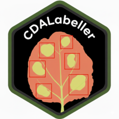
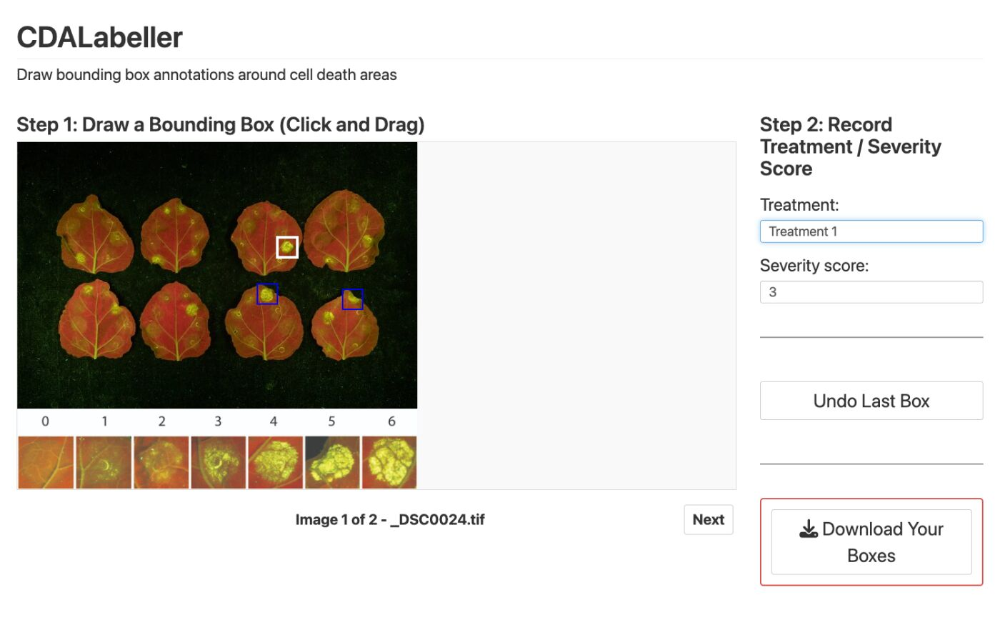

# CDALabeller 

<!-- badges: start -->

[](https://github.com/joshuandwilliams/CDALabeller/actions/workflows/R-CMD-check.yaml)
[](https://app.codecov.io/gh/joshuandwilliams/CDALabeller)
[](https://lifecycle.r-lib.org/articles/stages.html#experimental)


<!-- badges: end -->

CDALabeller is an app for annotating cell death areas (CDAs) in
agroinfiltration source images. Each source image shows several leaves,
and each leaf has several infiltration sites. You draw a bounding box
around each CDA and record its treatment. You also give it a cell death
severity score from 0 (no cell death) to 6 (strong cell death). The app
saves the annotations as a CSV file.
[AutoCDAScorer](https://github.com/joshuandwilliams/AutoCDAScorer) reads
that file to crop and score each CDA automatically.

<figure>

<figcaption aria-hidden="true">CDALabeller with three bounding boxes
drawn. The most recent box is white and earlier boxes are blue. The
scoring key is below the source image.</figcaption>
</figure>

## Installation

CDALabeller needs R 4.0.0 or later. Install it from GitHub with `pak`:

``` r
install.packages("pak")
pak::pak("joshuandwilliams/CDALabeller")
```

## Running the app

``` r
CDALabeller::run_app()
```

The app opens in your web browser. In Positron, it opens in the Viewer
pane instead. Closing the app’s tab stops the app, and any annotations
you have not downloaded are lost.

## What the app does

- **Upload.** Upload one or more source images as TIFF files. Each file
  can be up to 200 MB.
- **Draw.** Click and drag to draw a bounding box around a CDA. The box
  is extended to a square and kept inside the image. Every CDA is
  therefore cropped to the same shape.
- **Score.** Enter a treatment and a severity score for each CDA. The
  scoring key below the image shows an example CDA for each score.
- **Review.** Move between source images with Previous and Next. Undo
  removes the last bounding box you drew.
- **Download.** Save the annotations for all source images as one CSV
  file.
- **Trace.** Each row records when the bounding box was drawn. It also
  records the exact source image file and the version of CDALabeller
  used.

## Guide

The
[guide](https://github.com/joshuandwilliams/CDALabeller/blob/main/vignettes/CDALabeller.Rmd)
explains each step and every column of the CSV file.

The scoring key is adapted from Maqbool et al. (2015), *eLife* 4, e08709
(<https://doi.org/10.7554/eLife.08709>).

## Citing CDALabeller

``` r
citation("CDALabeller")
```
