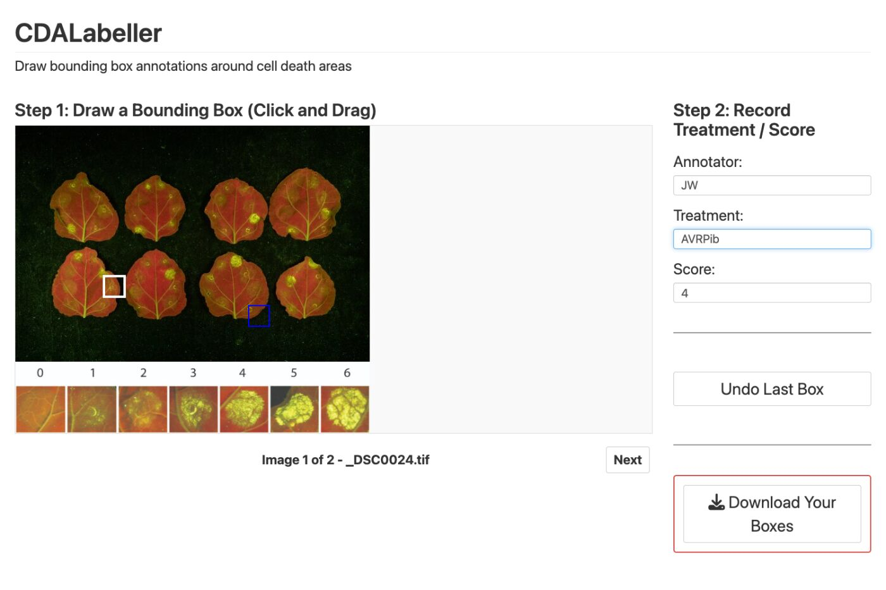

```{r, include = FALSE}
knitr::opts_chunk$set(collapse = TRUE, comment = "#>", eval = FALSE)
```

CDALabeller is an app for labelling cell death areas (CDAs) in photographs of
agroinfiltrated leaves. You draw a square around each area and give it a
treatment and a score. The app saves the squares as a CSV file. That file can
be read by [AutoCDAScorer](https://github.com/joshuandwilliams/AutoCDAScorer),
which scores cell death areas automatically.

## Starting the app

```{r}
CDALabeller::run_app()
```

The app opens in your web browser. In Positron, it opens in the Viewer pane.

The app keeps your boxes only while it is open. Closing its tab stops the app,
and any boxes you have not downloaded are lost.

## Labelling images

{width=100%}

1. **Upload.** Choose one or more `.tif` or `.tiff` images. Each file can be up
   to 200 MB. You can upload images once per session. Each file must have a
   different name, because the app stores boxes by file name.
2. **Annotator.** Enter your name or initials. They are saved with every box.
3. **Draw.** Click and drag on the image to draw a box. The app makes the box
   square by lengthening its shorter sides equally on both ends. If the square
   would cross the edge of the image, it is moved back inside. A box cannot be
   wider or taller than the image's shorter side. A click without a drag draws
   nothing.
4. **Treatment and score.** These fields apply to the most recent box, which is
   drawn in white. The score runs from 0 (no cell death) to 6 (strong cell
   death). Compare the area with the score key below the image. A score outside
   0 to 6 is outlined in red and saved as `NA`, meaning missing. You may leave
   either field empty.
5. **Undo Last Box** removes the white box.
6. **Previous** and **Next** move between images. Each image keeps its own
   boxes.
7. **Download Your Boxes** saves the boxes for all images as one CSV file.

## The CSV file

The file has one row per box. Each box is given in pixels of the original,
full-size image, not the smaller copy shown on screen. Pixels are counted from
the top-left corner of the image. `x` increases to the right and `y`
increases downwards.

A box starts at column `x1` and row `y1`. It ends just before column `x2` and
row `y2`. Its width is therefore `x2 - x1`, which equals its height `y2 - y1`.

| Column | Type | Meaning |
|---|---|---|
| `img` | text | Image file name, without its folder |
| `x1`, `y1` | whole number | Top-left corner of the box |
| `x2`, `y2` | whole number | Bottom-right corner of the box |
| `treatment` | text | The treatment entered, or `NA` |
| `score` | number | The score, from 0 to 6, or `NA` if empty or invalid |
| `annotator` | text | The annotator entered, or `NA` |
| `created_at` | text | When the box was drawn, in UTC, e.g. `2026-11-22T08:49:39.000Z` |
| `img_md5` | text | MD5 checksum of the image file |
| `labeller_version` | text | Version of CDALabeller that wrote the file |

An MD5 checksum is a 32-character code calculated from a file's contents.
Identical files have the same code, and any change to a file changes it. It
therefore identifies the exact image a box was drawn on, even if the file is
renamed or moved. To find a file's checksum, run `tools::md5sum("path/to/file")`.

## Using the CSV with AutoCDAScorer

`AutoCDAScorer::crop_and_load_images()` needs the columns `img`, `x1`, `x2`,
`y1` and `y2`. It ignores the other columns. It opens each `img` as a path to
a file.

The `img` column holds only the file name. This is because a web browser does
not tell the app which folder a file came from. There are two ways to deal with this.
You can run AutoCDAScorer with the image folder as R's working directory. Or
you can add the folder to each file name first:

```{r}
boxes <- read.csv("bounding_boxes_20260101_120000.csv")
boxes$img <- file.path("path/to/images", boxes$img)
write.csv(boxes, "boxes_with_paths.csv", row.names = FALSE)

crops <- AutoCDAScorer::crop_and_load_images("boxes_with_paths.csv")
```

## Files made by earlier versions

A CSV file with no `labeller_version` column comes from an earlier version of
CDALabeller. Those versions saved every box one screen pixel up and to the left of where it
was drawn. In image pixels, the error equals the image's full width divided by
its width on screen. For a 5568 pixel wide image shown 1200 pixels wide, that
is about 4.6 pixels.
